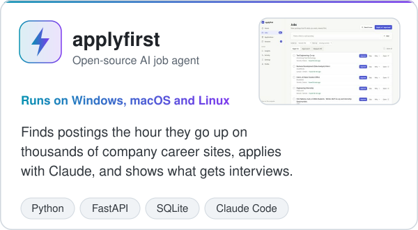
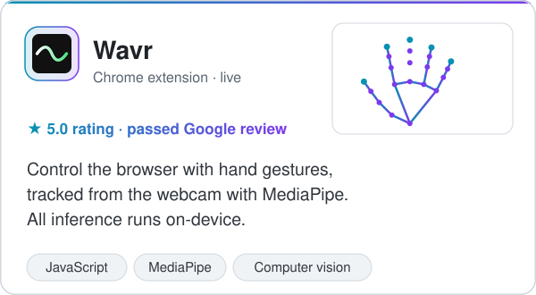
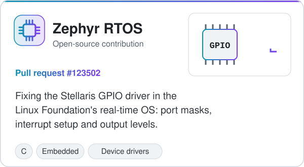
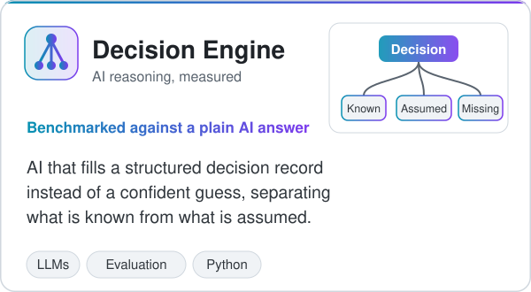
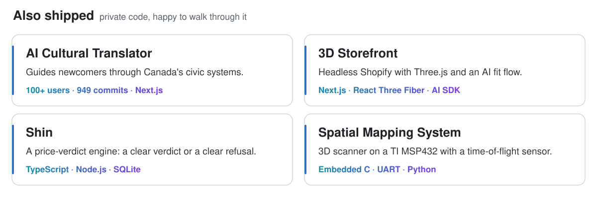

<picture>
  <source media="(prefers-color-scheme: dark)" srcset="assets/header-dark.svg">
  
</picture>

  
  
  

  <a href="https://github.com/xu826Jamin/applyfirst"><picture><source media="(prefers-color-scheme: dark)" srcset="assets/card-applyfirst-dark.svg"></picture></a>
  <a href="https://github.com/xu826Jamin/Wavr"><picture><source media="(prefers-color-scheme: dark)" srcset="assets/card-wavr-dark.svg"></picture></a>
  <a href="https://github.com/zephyrproject-rtos/zephyr/pull/123502"><picture><source media="(prefers-color-scheme: dark)" srcset="assets/card-zephyr-dark.svg"></picture></a>
  <a href="https://github.com/xu826Jamin/decision-engine"><picture><source media="(prefers-color-scheme: dark)" srcset="assets/card-decision-dark.svg"></picture></a>

<picture>
  <source media="(prefers-color-scheme: dark)" srcset="assets/shipped-dark.svg">
  
</picture>

<picture>
  <source media="(prefers-color-scheme: dark)" srcset="https://raw.githubusercontent.com/xu826Jamin/xu826Jamin/output/stats-dark.svg">
  
</picture>

<picture>
  <source media="(prefers-color-scheme: dark)" srcset="https://raw.githubusercontent.com/xu826Jamin/xu826Jamin/output/snake-dark.svg">
  
</picture>

  <picture>
    <source media="(prefers-color-scheme: dark)" srcset="https://skillicons.dev/icons?i=ts,js,py,cpp,c,nextjs,react,nodejs,fastapi,threejs,sqlite,docker,linux,git,vercel,githubactions&perline=8&theme=dark">
    
  </picture>

